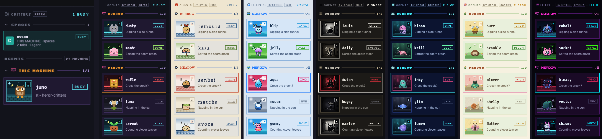

# herdr-critters

A Herdr desktop app mod with summary cards for spaces and a themed critter card
for each agent. Themes include retro pixel art, an Edo woodblock print, glossy
Y2K and neon cyberpunk.

- A collapsible **SPACES** section lists every space Herdr exposes, in Herdr's
  order. Each card shows its name, a local/remote machine icon, branch or
  folder, tab and agent counts, and the highest-priority agent status. Hover the
  icon for the machine name. The active space is highlighted;
  click a card to select it. Spaces without agents say `NO AGENTS`.
- Space cards use the agent cards' framed layout, with a large factory stage
  over the theme's agent-scene background and the space name, status, location
  and counts alongside it. One of eight themed
  factory silhouettes is assigned stably per space; its saved color appears as a
  small sign detail. Inactive factory icons are dimmed; for the active space,
  the slightly smaller factory leaves more of the scene visible as the background
  softly brightens, the sign pulses, and a few tiny color-matched dots twinkle.
  The `+` creates a space, right-click opens Herdr's space menu (including
  rename and close), and dragging reorders spaces within the same machine. In the
  included layout these cards replace the standalone Spaces panel, so spaces
  appear once.
- The **AGENTS** section keeps one themed critter card per agent: a sprite, the
  agent's theme-specific status box, and the session name (else the tab).
- Every agent gets a name from a list of 30 (4 to 7 letters, `names` in the
  theme), kept across restarts and never two the same. Each name is a
  character with its own sprite.
- Each sprite has one picture per status: idle (eyes shut), working (a bolt),
  blocked (a `!` and a sweat drop), done (happy eyes and a check). The sprite
  box background and border follow the status too.
- Agent cards are grouped by machine or by space: click `BY MACHINE` / `BY SPACE`
  in the AGENTS header. Each group header shows `busy/total`. A space header uses
  that space's color.
- The corner badge moves: `z` when idle, a spinner when working, a blinking `!`
  when blocked, a check when done. Working sprites bob.
- Click an agent card to focus its pane. Hover to pin or unpin.
- Click a group header to collapse it. Hover an agent card and click `-` to
  make it one thin line; `+` opens it again.
- Right-click an agent card for a menu: pin, collapse the card, or collapse its
  group.
- The fixed header has the dither icon and theme switch at the left and keeps
  the total working-agent count at the right. Under 160 px, a combined compact
  rail shows a create button and factory icons above the existing agent sprites.
- The look is a theme (see [Themes](#themes)). Click the theme button to cycle
  through the available looks.


## Install

Ask your Herdr agent:

> Read ~/.config/herdr-app/AGENTS.md, then add this layout: https://github.com/izerozlu/herdr-critters

To use the mod in a layout of your own, set its agents block to
`"content": { "mod": "herdr-critters" }`. The mod renders both spaces and
agents in that block and can replace a separate Spaces panel without losing
space creation, rename, close or reorder controls.

## Develop

```sh
./install.sh
```

This copies `mods/herdr-critters` to `~/.config/herdr-app/mods/` and runs
`herdr-app check`. Herdr reloads the mod live. Run it again after every change.
A symlink does not work: Herdr does not load a mod's images through one.

`RECIPE.md` is the brief another agent builds the mod from. Update it and
`preview.png` when the mod changes.

## Themes

Seven themes ship. Each has its own names and critters (30, or 12 in noir,
deepsea and garden), factory illustrations, colors, scenes, status words and
fonts.

| Theme | Look | Status words | Fonts |
| --- | --- | --- | --- |
| `retro` (default) | Dark pixel arcade: pixel critters, a dusk sky over bricks. | `IDLE` `BUSY` `HELP!` `DONE` | Silkscreen, VT323 |
| `edo` | An ukiyo-e woodblock print on washi paper: Japanese food and objects as vector critters with an ink outline. | `IDLE` `BUSY` `HELP!` `DONE` | Shippori Mincho, Yuji Syuku |
| `y2k` | Glossy Aqua, about 2000 to 2005: vector critters with a white shine, a wallpaper sky over green hills, a light silver panel. | `BRB` `SYNC` `OMG!` `W00T` | Orbitron, Share Tech Mono |
| `noir` | A 1940s detective city at night: 12 critters in costume as black cutouts against an office window with venetian blinds, all grays with one blood red. Raster PNG art. | `QUIET` `SNOOP` `HEAT!` `SOLVED` | Silkscreen, VT323 |
| `deepsea` | A bioluminescent deep sea at night: 12 sea creatures as soft see-through gel that glows from inside, over dark water with light shafts. | `DRIFT` `DIVE` `SOS!` `DOCK` | Silkscreen, VT323 |
| `garden` | A light cottage garden as a felt craft toy: 12 garden bugs and small animals in puffy matte felt with running stitches, felt hills and flowers. | `REST` `GROW` `WILT!` `BLOOM` | Silkscreen, VT323 |
| `cyber` | Neon cyberpunk: cute vector mascots (cyborg animals, drones, androids, hackers) with holo chrome and neon lights, a night city skyline over a grid floor. | `AFK` `HACK` `PING!` `SYNC` | Orbitron, Share Tech Mono |

### How theming works

A theme is data. `main.js` draws the view and reads every color, word, font,
name and art path from the active theme object. It never hard-codes a look.

- `themes/<id>/theme.js` holds the data (see `RECIPE.md` `## Themes` for the
  keys).
- `themes/<id>/art/` holds the pictures the view shows (SVG, or PNG for raster
  critter themes): sprites, scenes, icons and the eight factory illustrations.
  Factory illustrations are SVG in every theme.
- `themes/index.js` lists the themes. The header button cycles through them.

Runtime theme data and generated artwork live in `mods/herdr-critters/themes/<id>/`:

```
mods/herdr-critters/
  main.js
  icons/              laptop and network location indicators
  fonts/              shared by all themes
  themes/
    index.js          registry (THEMES, DEFAULT_THEME, themeById)
    retro/
      theme.js        colors, scenes, status words, names, fonts, art path
      art/            agent SVGs/PNGs plus the eight factory SVGs
    edo/              same layout
    y2k/              same layout
    noir/             same layout
    deepsea/          same layout
    garden/           same layout
    cyber/            same layout
```

The chosen theme id is shared state (`herdr-critters.theme`). A missing or
unknown id falls back to `retro`. Retro keeps its names in `localStorage` key
`names`; other themes use `names.<id>`.

### Add a theme

1. Copy `themes/retro/theme.js` to `themes/<id>/theme.js`. Change `id`, `label`,
   `art` and the values. Keep every key. `namesKey` is optional: it sets where
   the picked names are stored (default `names.<id>`; retro keeps `names`).
2. Add the art in `themes/<id>/art/` (`sprite-<name>-<status>.svg` for every
   name, `scene-<status>.svg`, `icon-machine-<scene>.svg` for every scene,
   `icon-dither.svg`). Make them with an art package (see [Art](#art)). For
   PNG agent art, the same names end in `.png`, and `theme.js` sets
   `artExt: "png"`. Add the theme's factory-art palette to
   `art/space_factory_art.py` too; the factory illustrations stay SVG.
3. Import it in `themes/index.js` and add it to `THEMES`. The order is the
   cycle order of the header button.

## Art

`art/generate.py` writes a theme's art to `mods/herdr-critters/themes/<id>/art/`
from the Python package `art/themes/<id>/`. It also writes the eight space-factory
SVGs from `art/space_factory_art.py`; those remain vector assets even for raster
critter themes. Agent-art packages draw in one of three ways:

- **Pixel grids** (retro): the package exports ASCII grids, one character per
  pixel, and per-status poses. The engine turns them into SVG and adds the
  status marks. See the `generate.py` docstring for the names a package exports.
- **Vector** (edo, y2k, cyber): the package sets `VECTOR = True` and draws the SVG
  text itself: `SPRITES` maps a name to a function of the status, and `SCENES`
  and `ICONS` map a name to SVG text. Each vector package has a `kit.py` with
  one face engine, so every critter poses the same way. Edo draws woodblock
  shapes with an ink outline. Y2k draws glossy bodies with a white shine: a
  `Critter` gives its body and face position, and the kit adds the eyes, mouth,
  blush and status marks. Cyber draws flat mascots with an ink outline, cel
  shadows, holo gradients and neon glows: each critter is a function of the
  status, and the kit gives it the eyes, mouth and status marks.
- **Raster**: the package sets `RASTER = True` and draws PNG files with any
  Python engine (Pillow, skia-python, pycairo). `SPRITES`, `SCENES` and `ICONS`
  work as for vector, but give PNG bytes, and the files end in `.png`. Set
  `artExt: "png"` in the theme's `theme.js` so the mod loads them. Draw sprites
  at 2x (320 x 256) and scenes at 576 x 480, so they stay sharp. Noir draws
  black cutout critters with skia-python: a `Critter` gives its silhouette, its
  few pale or red details and its face position, and the kit adds the backlight
  rim, the eyes, the mouth and the status marks. Deepsea draws soft gel with
  skia-python: a `Critter` is a list of parts (gel shapes, thick limbs, thin
  glowing strands) and its face position, and `kit.py` adds the glow, the face
  and the status marks. It saves 256-color PNGs with libimagequant
  (`imagequant`), so the files stay small. Garden draws felt with Pillow and
  numpy: its `kit.py` paints each shape as a felt piece (fuzzy edge, soft
  shadow, matte puffy shading, a running stitch) and holds the face engine; each
  batch file gives a critter's felt pieces and face position.

Edit the art, then:

```sh
uv run --no-project art/generate.py --theme <id>     # default: retro
./install.sh
```

A raster theme needs its engine: add it with `--with`. Noir:
`uv run --no-project --with pillow --with skia-python art/generate.py --theme noir`.
Deepsea also needs imagequant:
`uv run --no-project --with pillow --with skia-python --with imagequant art/generate.py --theme deepsea`.
Garden: `uv run --no-project --with numpy --with pillow art/generate.py --theme garden`.

`art/preview.py` draws a sheet of every sprite in every pose
(`art/preview-sprites.png`). Vector themes also need resvg; raster themes need
only Pillow:

```sh
uv run --no-project --with pillow art/preview.py --theme retro
uv run --no-project --with pillow --with resvg-py art/preview.py --theme y2k out.png
```

## Fonts

Retro, Noir, Deepsea and Garden use Silkscreen and VT323. Edo uses Shippori Mincho and Yuji Syuku, cut
to the Latin letters with `pyftsubset` so the files stay small. Y2k and cyber
use Orbitron and Share Tech Mono. All are under the SIL Open Font License (see
`mods/herdr-critters/fonts/LICENSE-*.txt`).
Herdr loads them from the mod's `fonts/` folder.

## Limits

- The palette is fixed per theme. It does not follow the Herdr theme.
- Past 30 agents, names repeat with a number (`pixel 2`) and share a sprite.
- Space factory silhouettes are assigned by space ID and kept in shared state.
  They remain stable across restarts, reordering and theme changes. The eight
  shapes are kept distinct while available; after that, new spaces reuse a shape
  without changing existing assignments.

## Thanks

Kudos to [typecraft](https://x.com/typecraft_dev/status/2117399278197108821)
for the inspiration.
