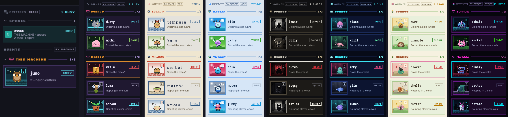

# Herdr critters

A Critters panel with compact summary cards for spaces and a themed critter
card for every agent. Each agent has its own sprite, standing in a scene that
changes with its status.

## What you see

The mod fills the layout's `agents` block:

- **Header** (38 px): a dither icon and theme button (shows the active theme,
  such as `RETRO`) at the left, and the total working-agent count at the right.
- **Spaces section**: a `SPACES` header with a chevron, total count and `+`
  button; it starts expanded and sits above the Agents section. Each card uses
  the Agent card's framed layout: a 74x62 factory stage on the left, with the
  space name and status, a local/remote machine icon plus branch/folder, and
  tab/agent counts at right. Hovering the icon reveals the machine name. The
  stage uses the theme's idle scene image like the agent cards, with its border
  blended into the scene background. The active space gets a subtle fill and
  saved-color border; its background gently brightens and its sign softly pulses,
  while the factory remains still. Inactive factory art is dimmed.
  Cards follow `spaces()` order.
- **Agents section**: an `AGENTS` header with the `BY MACHINE` / `BY SPACE`
  toggle. That toggle groups agents only. The existing themed agent cards,
  group headers and controls follow below it.
- **Agent cards**, 8 px apart, 10 px side padding, 2 px border and the scene's
  card color as fill. Left is a 74x62 sprite box; right is the name (VT323
  20 px) with a status box beside it, and the session name below.
- **Empty states**: `NO SPACES YET` when there are no spaces; `NO AGENTS` on an
  individual space card with no agents; `NO PLAYERS YET` and help text when the
  Agents section has no agents.
- **Narrow sidebar** (sidebar under 160 px wide): a combined compact rail shows
  factory icons and a create button above the existing 36x30 agent sprite boxes.

The palette is fixed per theme and does not follow the Herdr theme. Agent scenes
are local `dusk` (purple) or remote `den` (blue-gray), `dawn` (rust) and `moss`
(green) in turn. Space tiles and active-card accents use the saved colors from
the Spaces mod.

## How it behaves

- **Spaces**: one card per `spaces()` entry, including spaces without agents and
  remote spaces Herdr exposes. The list keeps Herdr's order: local first, then
  remote machines by name. Each card shows a laptop icon for the local machine
  or a network icon for a remote machine; hovering it shows the remote machine
  name. The card shows the branch, or the final folder component unless that
  repeats the title. Tab counts include
  settled tabs. Agent counts include every agent returned by `agents()`,
  including sub-agents. The status badge uses the active theme's word and color
  for the space's highest-priority status; `null` status displays `NO AGENTS`.
- Clicking a space card selects it. The `+` creates a space; right-click opens
  Herdr's standard space menu for rename and close; dragging reorders spaces
  within the same machine. The Spaces section is expanded by default; its
  collapse state is shared and persisted under `herdr-critters.spaces-collapsed`.
- A space's factory silhouette is assigned by space ID and stored in shared
  state (`herdr-critters.space-buildings`). It is stable across restarts,
  reordering and theme changes. Eight silhouettes are kept distinct while
  available; after the set is used, new spaces reuse a shape without changing
  existing assignments.
- Factory art is architectural and status-independent. It uses the same eight
  underlying silhouettes in every theme, rendered in that theme's visual style;
  the saved space color appears as a small sign detail, not as the icon's
  background. Inactive factory art renders at 55% opacity. For the active space,
  the background softly brightens and the sign pulses while the factory stays
  still.
- **Names**: each agent gets a random name from a list of 30 (pixel, byte,
  nova, rook, ziggy, mochi, bolt, echo, juno, kiwi, luma, miso, nimbus, onyx,
  pepper, quill, rusty, sprout, tango, umbra, vega, waffle, yeti, zephyr, comet,
  dusty, fable, gizmo, hopper, ivory). The `edo` theme has its own 30 (onigiri,
  sushi, dango, mochi, ramen, tofu, taiyaki, matcha, gyoza, bento, tempura,
  wasabi, sake, udon, natto, yuzu, miso, senbei, anpan, tamago, kokeshi, daruma,
  chochin, geta, sensu, furin, kendama, torii, kasa, maneki). The pick uses `crypto` random, never two
  the same, and is kept in `localStorage` by agent address across restarts (key
  `names` for retro, `names.<id>` for other themes). Past 30 agents a name
  repeats with a number (`pixel 2`) and shares a sprite.
- **Status**, on the agent's status box, sprite, scene and corner badge:
  - idle: the theme's idle word, eyes shut, badge `z`/`Z` blinking.
  - working: the theme's working word, a yellow bolt, badge a 4-frame spinner,
    the sprite bobs 3 px.
  - blocked: the theme's blocked word, red eyes, a `!` and sweat drop, badge
    `!` pulsing, the card border red.
  - done: the theme's done word, happy eyes, a green check, badge `✓`.
- The focused agent's card has an orange `#e8922e` border.
- Click an agent card to focus its pane (`pane.focus`). Hover shows a pin
  button; it runs `terminal.pin`. Pinned agents go first in their group.
- Click an agent group header to collapse the group. The collapsed groups are
  shared state (`herdr-critters.collapsed`, keyed by `space:<id>` or
  `machine:<name>`). Hover also shows a minus button beside the pin; it makes
  the card compact, one line with a 36x30 sprite box, the name and status (a
  plus button opens it again). Compact cards are shared state
  (`herdr-critters.compact`, keyed by agent address).
- Right-click an agent card (or a small sprite box) for a menu: pin/unpin,
  collapse/expand the card, or collapse/show its group. The pointer popup is
  this same mod, with `props().menu` set to the agent's address.
- The fixed header keeps the dither icon and theme button at left and the total
  working-agent count at right. The `BY MACHINE` / `BY SPACE` toggle lives in the Agents header
  and affects only agent groups. The theme button is shared state
  (`herdr-critters.theme`; unknown or missing means `retro`).
- The agent list order is sent to Herdr with `setAgentOrder`.

## Built from

- **Layout** `layouts/critters.json`: the custom layout replaces the standalone
  Spaces block with `{ "mod": "herdr-critters" }` in its sidebar list, avoiding
  duplicate space navigation.
- **Mod** `mods/herdr-critters/`: `main.js` (one `View`, theme-agnostic),
  `mod.json` (`place: none`), `themes/` (registry `index.js` and one folder per
  theme with `theme.js` and `art/`), `icons/` (local laptop and remote network),
  and `fonts/`.
- **herdr functions**: `agents`, `terminals`, `spaces`, `machines`, `layout`,
  `theme`, `shared`, `setShared`, `setAgentOrder`, `run`, `openOverlay`,
  `closeOverlay`, `props`.
- **Commands**: `space.select`, `space.new`, `space.move`, `pane.focus`,
  `terminal.pin`.
- **Shipped mods it uses**: the standard `menu` for space management, plus the
  `pin`, `pin-off`, `plus`, `minus`,
  `chevron-down` and `chevron-right` icons of
  `workspace-chrome`.
- **Programs, network, files**: none. It does not run programs, reach the
  network or read files outside its own folder.
- **Art**: Theme assets in `mods/herdr-critters/themes/<id>/art/`: one sprite
  per agent name and status (`sprite-<name>-<status>`), a scene per status
  (`scene-<status>`), machine icons, and eight space-factory silhouettes
  (`space-<type>.svg`). Factory icons are SVG in all themes and use the same
  underlying silhouettes with a theme-specific finish. They are generated by
  `uv run --no-project art/generate.py --theme <id>` (default `retro`), with the
  factory artwork defined in `art/space_factory_art.py`. Agent art is generated
  from `art/themes/<id>/`: ASCII grids for retro (pixel art), drawing code for
  edo (vector woodblock prints), y2k (glossy vector critters) and cyber (neon
  vector mascots). Raster agent themes draw their assets as PNG: noir (black
  cutout critters, drawn with skia-python; run generate.py with
  `--with pillow --with skia-python`), deepsea (soft gel critters, drawn with
  skia-python; also `--with imagequant`) and garden (felt craft critters,
  painted with Pillow and numpy; run generate.py with `--with numpy --with pillow`).
- **Fonts**: Silkscreen and VT323 (retro, noir, deepsea, garden), Shippori Mincho and Yuji Syuku cut
  to Latin letters (edo), Orbitron and Share Tech Mono (y2k, cyber), all SIL Open Font
  License, in `fonts/`.

## Themes

A theme is `themes/<id>/theme.js`, a default export of one object:

- `id`, `label` (shown on the header button), `art` (art folder path),
  `fonts` (`pixel`, `mono`, optional `monoSize` and `monoLine` for the name
  text, default 20 and `18px`), optional `namesKey` (storage key for names) and
  optional `artExt` (the art files' type, `"svg"` by default, `"png"` for
  raster art).
- `colors`: `bg`, `head`, `machine`, `focus`, `text`, `sub` and the rest the
  view uses (badge, borders, hover, dividers).
- `scenes` (each `card`, `edge`, `box`, `label`), `localScene` and
  `remoteScenes`.
- `status`: `working`, `blocked`, `done`, `idle`, each `{ word, color }`.
- `names`: the 30 agent names; each needs its sprites in `art/`.

`themes/index.js` exports `THEMES` (cycle order), `DEFAULT_THEME` (`retro`) and
`themeById(id)` (unknown id gives the default). To add a theme: write
`theme.js`, add the art, import it in `index.js` and add it to `THEMES`.
